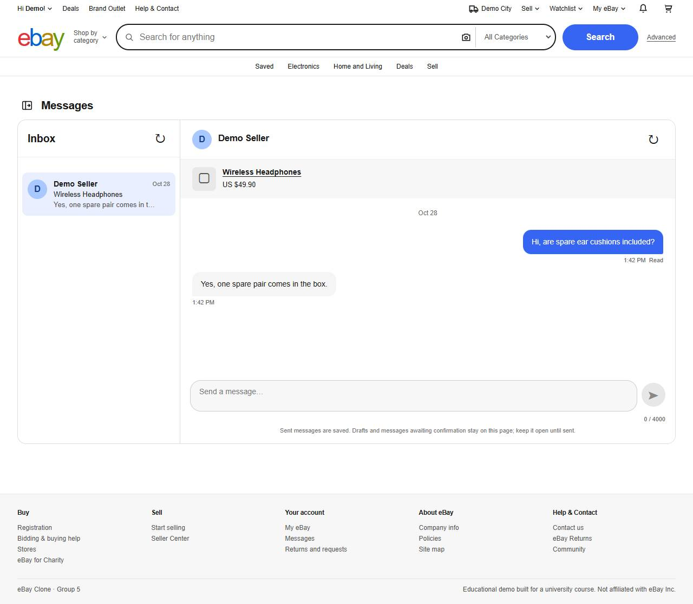
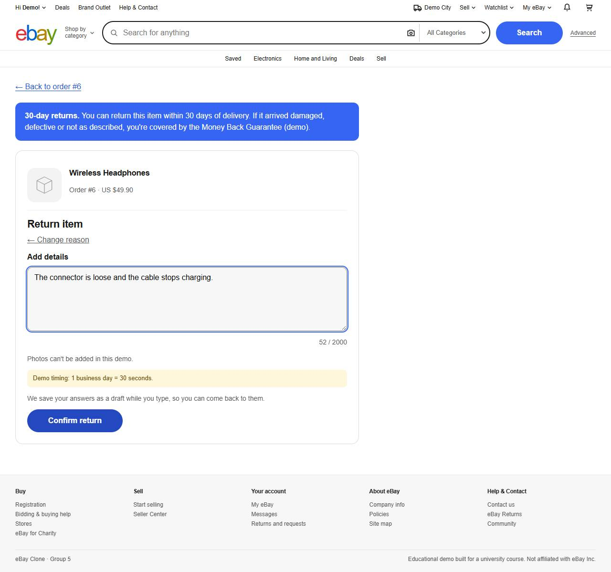
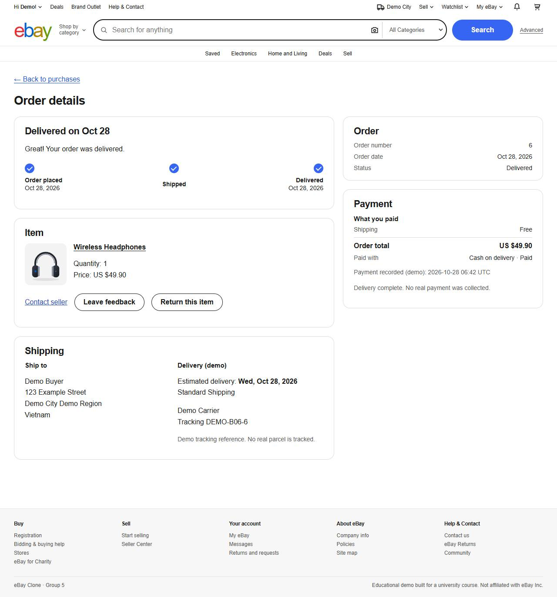

# Báo cáo dự án eBay Clone — Nhóm 5

Ngày tổng hợp: **08/10/2026** (Asia/Saigon), cập nhật UI đợt H **28/10/2026** ([H07](../tasks/H07.md)). Ngày nộp: **chưa xác định**.
Repository private: [Twiash/EbayGroup5](https://github.com/Twiash/EbayGroup5).
Đề bài lưu tại [requirements-extracted](../requirements/sources/requirements-extracted.md).

**Kết quả bàn giao:** 40/40 task kỹ thuật hoàn tất; DOC-01 đã bàn giao.
[CI37709417510](https://github.com/Twiash/EbayGroup5/actions/runs/37709417510) và
[clone sạch/demo evidence](../evidence/G02.md) pass trên runtime `e635866`.
**OPS-04 còn Pending theo user** (Jira live làm sau); việc rehearsal/giải thích
của từng thành viên là checklist chuẩn bị, không ghi nhận đã xảy ra.

## 1. Mục tiêu và phạm vi

Dự án môn C#/.NET triển khai Interaction Layer của nhóm 5: chat buyer–seller,
đánh giá sản phẩm sau mua hàng, feedback/uy tín seller và khiếu nại.
Theo [ADR-002](../decisions/ADR-002-group5-fidelity.md), UI/nghiệp vụ nhóm 5 dựa trên
nguồn eBay; phần buyer/seller/admin/payment/shipping của nhóm khác được giản lược
để demo độc lập. Không tuyên bố đây là toàn bộ hệ thống eBay hoặc dịch vụ production.

Tính năng hỗ trợ gồm tài khoản, catalog, checkout COD, lịch sử đơn và ship/receive mô phỏng.
Không có thanh toán thật, vận chuyển thật, upload ảnh sản phẩm, đấu giá đầy đủ,
social login hoặc marketplace đa tiền tệ.

## 2. Kiến trúc

```text
Browser (MVC/Razor + JS, HTTPS/WSS)
                    │
             Nginx TLS/proxy
                    │
         ASP.NET Core Web ×2 replica
          │                      │
 SQL Server /EF query       Redis backplane
  durable messages         key ring/rate limit/
  orders + audit           session revocation
          ▲
   DbUp migration Job/CLI (identity riêng)
```

Solution modular monolith .NET 8: Core (entity), Application (contract/rule),
Infrastructure (service/EF), Web (controller/SignalR/Razor) và Database (DbUp).
Web không tự tạo schema hoặc seed trong startup. Redis phân phối event,
SQL giữ lịch sử bền vững. Không có outbox đảm bảo push hoặc E2EE.
Client phục hồi lịch sử bằng cursor; replay cùng UUID không tạo thêm tin.

Demo hỗ trợ Docker Compose và Kubernetes kind một node. Web có startup/liveness/readiness,
non-root/read-only rootfs, hai replica; SQL/Redis có volume. Nginx kết thúc TLS;
NetworkPolicy giới hạn truy cập DB/web/Redis. [K8S](../architecture/K8S.md),
[DEPLOYMENT](../architecture/DEPLOYMENT.md), [SCALE_OUT](../architecture/SCALE_OUT.md).

## 3. Database và bảo toàn đề bài

Giữ nguyên schema nguồn **17 bảng**, kiểu dữ liệu, PK/FK/unique hiện có;
nguồn có SHA-256 `D56EC9C0FFCEA721E2F7BA3453249794F03AFEB1F17CC4A2F9EBD0ADA38E0754`.
DbUp quản lý **0001–0014**, gồm baseline và các phần mở rộng; EF Core chỉ mapping/query.
Seed A06-v1 có journal và transaction/lock; chạy lại không reset dữ liệu đã sửa.
Migration/seed identity riêng với runtime login ít quyền; không rollback database bằng DROP.
[DATABASE](../architecture/DATABASE.md), [runbook](../runbooks/DATABASE.md).

## 4. Luồng nghiệp vụ nhóm 5

| Module | Hành vi và điều kiện chính | Contract |
|---|---|---|
| Chat | Cookie principal, membership theo buyer/seller; SQL commit trước event, UUID idempotent, sequence/cursor string, inbox/read, reconnect/rejoin/catch-up | [CHAT](../architecture/CHAT.md) |
| Product review | Buyer owner của dòng hàng Delivered, một review/OrderItem; mua lại được review mới; rating 1–5, comment tuỳ chọn; aggregate theo nội dung hợp lệ | [REVIEWS](../architecture/REVIEWS.md) |
| Seller feedback | Sentiment độc lập rating sản phẩm; score P−N, %positive 12 tháng, cửa sổ lịch sử, seller reply một lần; report/moderation/audit | [FEEDBACK](../architecture/FEEDBACK.md), [MODERATION](../architecture/MODERATION.md) |
| Dispute | INR sau ngày giao dự kiến, Return sau nhận; draft server/reload; buyer/seller dashboard/timeline; seller response, automation chuyển quá hạn; admin quyết định có audit | [DISPUTES](../architecture/DISPUTES.md), [DISPUTE_ADMIN](../architecture/DISPUTE_ADMIN.md) |

Refund là **kết quả mô phỏng**, không gọi payment gateway hoặc chuyển tiền.
Quyền kiểm tại từng object; client không quyết định sender/owner/seller/giá/role.
Mốc hạn và quy tắc đã chốt theo contract, không coi toàn bộ giản lược là chính sách eBay thật.

## 5. UI và đối chiếu eBay

Đợt H ([ADR-003](../decisions/ADR-003-ui-fidelity-references.md), H00–H06) làm lại mọi màn theo ảnh eBay
đã chốt trong [references](../references/ui/INDEX.md): header/trang chủ, tìm kiếm, trang sản phẩm có ảnh demo,
feedback profile, checkout, đăng nhập/đăng ký, My eBay (Purchases, Order details, Account).
H07 chụp lại **26 màn × desktop 1280 / mobile 390 = 52 ảnh**, 0 tràn ngang và 0 vi phạm CSP.
Ảnh, nguồn và phân loại: [UI_ACCEPTANCE](../architecture/UI_ACCEPTANCE.md),
[gallery](../evidence/ui/), [UI_CANDIDATES](../architecture/UI_CANDIDATES.md).







Các khác biệt đã duyệt: chỉ COD và một lựa chọn giao hàng, không giỏ hàng/watchlist (mở trang thông báo), COD/ship/receive mô phỏng,
request details/admin tự thiết kế theo contract vì không có mẫu eBay công khai,
không đính kèm ảnh khiếu nại, nút refresh/nhãn Read của chat; badge tin chưa đọc
trên menu được hoãn (Q-UI-010). Còn lại sau H07: form/màn khiếu nại và form feedback chưa hiện ảnh sản phẩm
(placeholder), Messages chưa theo bố cục M2 2026 — ghi ở UI_ACCEPTANCE. Các màn/điểm vào của nhóm 5 đã được review;
không tuyên bố mọi màn của clone trùng eBay.

## 6. Kiểm thử và bảo mật

Checkpoint G01: **263 .NET + 20 Node pass**, build 0 warning; SQL integration,
HTTP/socket, browser journeys, access matrix, IDOR/CSRF/XSS, TLS/security headers,
secret scan lịch sử và NuGet audit. [CI37689369159](https://github.com/Twiash/EbayGroup5/actions/runs/37689369159).

Cookie Secure/HttpOnly, CSRF trên POST, WebSocket exact Origin, object authorization,
log chỉ metadata/trace và không nội dung chat/secret. Key ring/rate limit/thu hồi phiên
dùng Redis cho nhiều instance. Redis outage và giới hạn thực ghi trong
[SECURITY_TESTS](../architecture/SECURITY_TESTS.md) và [CHAT_RECOVERY](../runbooks/CHAT_RECOVERY.md).

## 7. Tải, CD và rolling update

| Bài đo | Kết quả đã có | Bằng chứng |
|---|---|---|
| F05 Full JMeter/SignalR | Dataset 100k tin / 10k review / 1k dispute; 50 user × 10 phút, 0% lỗi, p95 HTTP ≤ 39 ms; 20 cặp chat p95 20,4 ms, 11.753/11.753 tin | [F05](../evidence/F05.md) |
| F05 Stress | Đến 800 user p95 < 100 ms; 1600 user inbox p95 khoảng 1,3 s; giới hạn máy/bài đo, không SLA | [LOAD](../architecture/LOAD.md) |
| F07 CD | Hosted build image full SHA, artifact checksum/digest/platform/revision verified; Windows ephemeral runner deploy kind, 2 Ready, TLS smoke; deregister/không service | [CD37669952216](https://github.com/Twiash/EbayGroup5/actions/runs/37669952216), [F07](../evidence/F07.md) |
| F08 Full rolling/undo | 50 HTTP user + 20 cặp / 600 s; 152.130 request, 0 lỗi/5xx/network; 12.891 ACK đủ/một dòng SQL; 80 reconnect, max 2,51 s; max HTTP p95 241,48 ms / chat 27,98 ms | [F08](../evidence/F08.md) |

Rolling/rollback kiểm image tương thích/cùng binary nghiệp vụ trên một node kind;
không chứng minh SQL/Redis failover, node outage, hoặc rollback schema không tương thích.
Số đo gắn cấu hình máy trong evidence, không suy rộng thành dung lượng production.

## 8. Truy vết và bàn giao

Toàn bộ requirement/status/acceptance: [MATRIX](../requirements/MATRIX.md).
Index bằng chứng: [evidence/INDEX](../evidence/INDEX.md); bảng tổng hợp G01:
[evidence/G01](../evidence/G01.md). G02 bổ sung hướng dẫn [SETUP](SETUP.md),
kịch bản [DEMO](DEMO.md), và [HANDOVER](HANDOVER.md).

OPS-04 **Pending theo yêu cầu người dùng**, vì chưa đồng bộ Jira thật;
backlog đã có key/account mapping, không tạo trùng hoặc giả worklog.
G02 tài liệu/setup/demo tách khỏi lần đồng bộ sau. Việc từng thành viên tự chạy
và giải thích module là bước luyện tập con người; không ghi nhận đã diễn ra khi chưa có xác nhận.

## 9. Thành viên và trách nhiệm trình bày

| Người | Phần phụ trách | Minh chứng nên giải thích |
|---|---|---|
| Tran Van Dat (TV1) | Foundation/commerce | 17 bảng, DbUp/EF, checkout transaction, owner/Delivered |
| Đoàn Công Huy (TV2) | Chat | SQL durability, SignalR/Redis, UUID/cursor/read/recovery |
| Pham Van Cuong (TV3) | Reviews/reputation | Product rating vs seller sentiment, score/%positive, moderation/audit |
| Nguyên Nguyễn (TV4) | Disputes | Draft, state machine, business-day clock, worker/admin audit |
| Hải Lê (TV5) | DevOps/quality | Nginx/TLS,2 replica,CI/CD,load,kind/rollout/undo và bàn giao |

Codex hỗ trợ triển khai/kiểm thử/tài liệu; không thay thế trách nhiệm hiểu và trình bày
của thành viên. Không gán các commit hoặc review tự động cho người chưa thực hiện.
